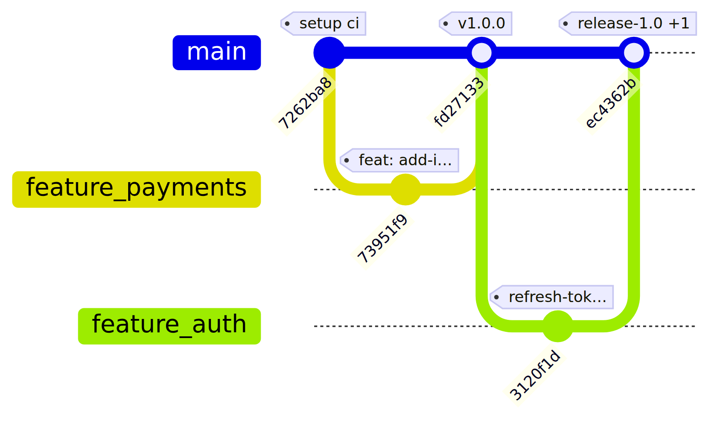

# pi-skill-gitgraph

Skill per [pi](https://pi.dev) che trasforma la storia di un repository Git in un **grafo Mermaid
`gitGraph`** con rami, fork e merge ricostruiti (non una fila indiana), più — opzionalmente — il
rendering PNG locale.



*Esempio generato con `mmdc 12.0.0` (§Install) e il Chromium risolto da `chrome_bin()` su un repo di
prova con due rami e due merge, `--label-len 12` per un grafo stretto; la versione del browser non è
registrata nell'asset. I merge portano l'id del commit di merge, i tag git compaiono come `tag:` (se
il commit ne ha più di uno: il primo più `+N`), i subject sono troncati a `--label-len` caratteri
(default 32, **ellissi `…` compresa**) a confine di parola, con taglio duro se il confine
lascerebbe meno di metà del testo. Ricetta:
`python3 skills/gitgraph/scripts/gitgraph.py <repo> -n 20 --label-len 12 --png out.png`. Con un altro
renderer, altri font o un altro Chromium layout e byte cambiano: è un'**illustrazione, non un golden
file** (nessun test confronta i byte).*

Output possibili (comandi eseguiti dalla radice del pacchetto, `<repo>` = repository da analizzare):

| Cosa | Comando | Destinazione |
|---|---|---|
| Mermaid puro | `python3 skills/gitgraph/scripts/gitgraph.py <repo>` | incollabile su <https://mermaid.live> |
| file `.md` con fence `mermaid` | `python3 skills/gitgraph/scripts/gitgraph.py <repo> -o grafo.md --md` | preview di VS Code (`Ctrl+Shift+V`) |
| immagine | `python3 skills/gitgraph/scripts/gitgraph.py <repo> --png grafo.png` | report, Telegram, documenti |

Destinazioni esclusive: `--png` **non si combina** con `-o` né con `--md` (errore, exit 2: scegli
una destinazione); `-o` con `--md` resta valido (fence nel file), `-o` da sola scrive Mermaid puro,
`--md` da sola manda il fence su stdout. Per avere sia il PNG sia il `.md` esegui lo script due
volte, una con `--png` e una con `-o grafo.md --md`.

## Requirements

| Componente | Versione / note | Obbligatorio |
|---|---|---|
| `python3` | ≥ 3.8 (testato su 3.14) | sì |
| `git` | ≥ 2.20 (testato su 2.53) | sì |
| `mmdc` (`@mermaid-js/mermaid-cli`) | `12.0.0` esatta (l'asset è generato con questa; un'altra 12.x avvisa ma non blocca) | no, solo `--png` |
| Chromium | uno qualsiasi fra i percorsi in `references/png-setup.md` | no, solo `--png` |
| `pi` | ≥ 1.4 (pacchetti `pi` + skill) | sì per l'uso come skill |

Nessuna dipendenza Python esterna: solo standard library. Nessuna chiamata di rete: tutto locale,
tranne il caso in cui **tu** decidi di incollare il grafo su mermaid.live.

## Install

Da path locale (senza copiare nulla: il pacchetto è caricato dal path):

```bash
pi install /percorso/pi-skill-gitgraph
```

Da repository Git — **senza ref** = installa/sempre aggiornata all'ultima versione online
(`pi update` riallinea il checkout al `main`):

```bash
pi install git:github.com/axxx75/pi-skill-gitgraph
```

⚠️ Non usare `@v1.0.1`: un tag/commit come ref è **pinnato per sempre** e `pi update` non lo
sposta più (docs pi `packages.md`). Un ref serve solo per fissare una versione nota.

Verifica che il pacchetto sia dichiarato:

```bash
pi list          # deve comparire pi-skill-gitgraph
```

In alternativa, senza toccare la configurazione (una sola invocazione):

```bash
pi -e /percorso/pi-skill-gitgraph
```

La skill si attiva da sola quando la richiesta la riguarda, oppure in modo esplicito:
`/skill:gitgraph mostra la storia di ~/progetti/repo`.

### `--png` (opzionale)

```bash
PUPPETEER_SKIP_DOWNLOAD=1 npm i -g --prefix ~/.local --ignore-scripts @mermaid-js/mermaid-cli@12.0.0
ln -sf ~/.local/lib/node_modules/@mermaid-js/mermaid-cli/src/cli.js ~/bin/mmdc
mmdc --version          # atteso: 12.0.0
```

La versione è **esatta**: due 12.x installate a mesi di distanza possono produrre PNG diversi, e
`--ignore-scripts` non esegue gli script di install del pacchetto (`PUPPETEER_SKIP_DOWNLOAD=1` evita
comunque il download di Chromium). Il selftest confronta `mmdc --version` con `12.0.0` e, se diversa,
lo dice su `stderr` proseguendo col render: è un avviso, non un fallimento.

Chromium: la skill riusa quello che trova (browser-tools di pi, cache puppeteer/playwright,
chromium di sistema) oppure quello indicato da `PUPPETEER_EXECUTABLE_PATH`.
Dettagli e diagnosi: [`skills/gitgraph/references/png-setup.md`](skills/gitgraph/references/png-setup.md).

## Verify

```bash
bash skills/gitgraph/tests/selftest.sh
```

Cosa fa: costruisce repo usa-e-getta (ramo `feature/x`, un merge `--no-ff`, un tag; poi un repo a
un commit, un repo vuoto e un clone shallow) e verifica

- prima riga = direttiva `%%{init:...}` e presenza di `gitGraph`;
- `branch feature_x` e `merge feature_x id:` presenti (slash sanificato, merge ricostruito);
- `tag: "v1"` riportato dal tag git reale;
- etichette: troncatura a confine di parola con `…`, `--label-len` rispettato, con più tag compare il primo e `+N`; su un subject convenzionale reale (`feat: add-idempotency-key-rotation`) l'etichetta conserva almeno metà del limite e i caratteri distintivi (niente `feat:…`);
- numero di `commit id:` esatto (5);
- con `--linear` l'output resta Mermaid valido: prima riga `%%{init:...}`, `gitGraph` presente, almeno un `commit id:`, anche con HEAD non risolto (ref puntato ma mai committato);
- `--md` apre e chiude il fence, l'output raw **non** contiene fence;
- un file, un path inesistente o un bare repo vengono rifiutati con exit 1 **e** il messaggio `non e' un repository git` (il testo, non solo l'exit code);
- `-o` scrive un file byte-identico a stdout, senza `.tmp` orfani, e rifiuta una directory inesistente con una riga su stderr;
- `-n` è davvero la finestra: `-n 2` dà esattamente 2 `commit id:`, `-n 0` esce con 2 e `serve -n >= 1`;
- un repo a un solo commit produce un grafo con un commit; un repo vuoto esce con 1 e `nessun commit trovato`; un clone `--depth 1` produce un grafo valido;
- escaping e parsing: `"`, `\`, `#`, backtick e caratteri di controllo nel subject o nel tag restano renderizzabili; un subject con `|` non rompe il log; un tag in formato inatteso esce con `tag non interpretabile`;
- collisione di nomi sanificati (`feature/x` + `feature_x`): due lane distinte, warning su stderr;
- `--png` produce un file non vuoto (se `mmdc` è installato, altrimenti `SKIP`); una `mmdc --version` diversa da `12.0.0` produce un `WARN` su stderr, non un fallimento.

Lo script gira con `set -euo pipefail`: un comando che fallisce ferma il test (nessun falso verde) e
`git init -b` ha un fallback senza `-b` per git < 2.28.

Output atteso: `OK` e exit code 0. Qualunque altra cosa è un fallimento.

**Copertura**: scenari sintetici costruiti all'istante, non un repo reale.
**Non coperto**: (a) il fallback `git init` senza `-b` non è esercitato su un git moderno (il primo
tentativo riesce sempre): è codice di compatibilità non provato; (b) l'aspetto del PNG (font,
sovrapposizione e taglio delle etichette, contrasto) e le differenze fra renderer; (c) storie reali
grandi, con molti rami/merge e ref remoti, dove `-n` e la ricostruzione delle lane degradano. Un `OK`
qui significa «il contratto CLI verificato da questi casi funziona», non «ogni storia git produce il
grafo giusto».

### CI

[`.github/workflows/ci.yml`](.github/workflows/ci.yml) gira su push di `main`, sui tag `v*` e sulle
pull request: `selftest.sh` + `py_compile` su Python 3.8 e 3.12, un job `png` (mmdc 12.0.0 + Chromium,
dove lo `SKIP` non è ammesso), e `gitleaks` su tutta la storia. Lo stesso gate in locale, senza runner:

```bash
bash skills/gitgraph/tests/selftest.sh          # locale: --png può finire in SKIP se manca mmdc
python3 -m py_compile skills/gitgraph/scripts/gitgraph.py skills/gitgraph/tests/test_gitgraph.py
```

Verifica manuale su un repo vero:

```bash
python3 skills/gitgraph/scripts/gitgraph.py ~/un/repo -n 15
python3 skills/gitgraph/scripts/gitgraph.py ~/un/repo -n 15 -o /tmp/grafo.md --md
python3 skills/gitgraph/scripts/gitgraph.py ~/un/repo -n 15 --png /tmp/grafo.png
```

## Usage

| Opzione | Significato |
|---|---|
| `REPO` | path del repository (default `.`) |
| `-n N` | finestra di ricostruzione in commit, default 30 (vedi §`-n`: finestra di ricostruzione) |
| `-o FILE` | scrive su file invece che su stdout |
| `--md` | avvolge l'output nel fence ```` ```mermaid ```` |
| `--png FILE` | renderizza il PNG con `mmdc` (largo 1600 px, sfondo bianco); niente stdout; incompatibile con `-o`/`--md` (exit 2), vedi §Output possibili |
| `--linear` | fila indiana, un solo ramo: ripiego se la ricostruzione esce sbagliata |
| `--label-len N` | caratteri massimi del testo dell'etichetta, troncato a confine di parola con `…` (default 32, ellissi compresa, `0` = soggetto intero); con più tag `+N` è accodato a parte; l'escaping può allungare la stringa (es. `#` → `#35;`) |

`stdout` è Mermaid puro; i warning vanno su `stderr`. La frase dei due warning è contratto con
l'agente (la skill reagisce a quelle stringhe) e resta invariata: dopo, tra parentesi, arriva l'hint
operativo con il `-n` suggerito (`-n 60` con il default 30). Con `-o` il messaggio di successo su
`stderr` è `N commit -> /path/assoluto`: conta i soli `commit id:`, non le direttive Mermaid.

**Etichette e leggibilità:** Mermaid disegna le etichette con una spaziatura fissa (~40 unità SVG
per commit) e non la espone in configurazione: oltre ~8 caratteri le etichette di commit adiacenti
nella stessa lane possono sovrapporsi e restare tagliate. Non è aggirabile dallo script né dal PNG
già renderizzato (il PNG è un artefatto del renderer, non un file modificabile). Per un grafo
leggibile resta `--label-len` contenuto (10-12) e/o `-n` ridotto, accettando subject abbreviati.

Un merge si ricostruisce solo con **entrambi i genitori** nella finestra di commit: se `stderr`
segnala `commit fuori dalle catene principali` o `merge non ricostruiti`, rilancia con `-n` più alto.

## `-n`: finestra di ricostruzione

`-n` (default 30) non è un "numero massimo di commit": è la **finestra di ricostruzione**. È il
numero di commit che `git log --all --topo-order` restituisce, e la ricostruzione delle lane lavora
solo su quelli; la catena first-parent di ogni tip viene percorsa **dentro** la finestra. Per questo
alzare `-n` "aggiusta" il grafo: fa rientrare i genitori di un merge, che senza entrambi non è
ricostruibile (e il commit finisce in una lane laterale o in un warning). Il costo cresce con i
rami: più tip = più catene da percorrere e due `git for-each-ref` su tutti i ref, quindi su un repo
con molti rami/ref remoti conviene partire bassi e alzare solo se `stderr` segnala merge non
ricostruiti. `-n < 1` è rifiutato (exit 2): non esiste una finestra vuota.

## Limiti noti

Comportamenti verificabili che non si aggirano dai flag:

- **Bare repo rifiutati**: in un bare repo `--is-inside-work-tree` è `false`, quindi lo script esce
  con `non e' un repository git` (exit 1). Non è un guasto: senza worktree non c'è una storia da
  disegnare. Workaround: clonare il repo (`git clone <path>`) e passare il clone.
- **Directory di output non create**: `-o` e `--png` richiedono che la directory esista già
  (`directory inesistente`, exit 1): lo script non crea cartelle. Workaround: `mkdir -p` prima.
- **Una destinazione per invocazione**: `--png` è incompatibile con `-o`/`--md` (exit 2); per avere
  sia il PNG sia il `.md` esegui lo script due volte.

Casi **risolti** — comportamento definitivo, non più limiti:

- **Tag con spazio** (`release 1.0`): git non li crea (`check-ref-format`); se un ref arriva
  comunque in un formato inatteso lo script esce con `tag non interpretabile: <riga>` (exit 1), non
  con un traceback. Un subject con `|` non confonde più il parsing del log (separatore di campo
  esplicito).
- **Escaping Mermaid**: `"`, `\`, `#` e backtick sono neutralizzati (`'`, `#92;`, `#35;`, `#96;`) e
  i caratteri di controllo diventano `#65533;`, in un unico punto (`escape()`): il grafo resta
  renderizzabile anche con subject ostili.

## Troubleshooting

| Sintomo | Causa | Rimedio |
|---|---|---|
| `mmdc non trovato` | `mmdc` non nel `PATH` | vedi §Install: symlink in `~/bin` o `PATH` che include `~/.local/bin` |
| `chromium non trovato` | nessun Chromium nei percorsi noti | `export PUPPETEER_EXECUTABLE_PATH=/path/al/chrome` |
| `mmdc fallito: ...` | Chromium incompatibile o `--size` assente (major vecchia) | verifica `mmdc --version` e `mmdc --help` |
| `non e' un repository git` | path sbagliato, non un repo, un bare repo o una sottodirectory senza worktree | passa la radice del repo (con `.git`): un bare repo non ha una storia da disegnare |
| Grafo "a fila indiana" | finestra `-n` troppo piccola, merge fuori | `-n` più alto, o `--linear` se vuoi davvero la fila |
| Etichette che si sovrappongono / si tagliano nel PNG | spaziatura fissa di Mermaid gitGraph (~40 unità per commit), non configurabile | `--label-len` contenuto (10-12) o `-n` ridotto; il PNG già renderizzato non è modificabile dallo script |
| Repo con `main` divergente da `origin/main` | due lane: è la storia reale | nessuna azione |
| Skill `gitgraph` duplicata (pacchetto + copia in `~/.pi/agent/skills/gitgraph`) | pi carica la **prima** trovata e stampa un warning di collisione | rimuovi la copia vecchia: `pi config` → Resources |

## Privacy

Nessun dato esce dalla macchina. Attenzione solo a un caso: incollare il grafo su **mermaid.live**
manda i subject dei commit e i nomi dei rami a un servizio esterno. Per repo privati, non farlo
senza averlo chiesto al proprietario.

## Uninstall

```bash
pi remove /percorso/pi-skill-gitgraph    # o: pi remove git:github.com/axxx75/pi-skill-gitgraph
```

Lo script non scrive nulla di nascosto: nessun file di stato, nessuna cache, nessun file dentro il
repository target. Scrive solo dove glielo chiedi — `-o FILE` e `--png FILE`, con qualunque path,
anche fuori dal repo — più due file temporanei in una `TemporaryDirectory` di sistema (`in.mmd`,
`puppeteer.json`), cancellata all'uscita. Per l'uninstall basta rimuovere i file che hai creato tu:
il pacchetto non lascia residui propri.

## License

MIT — vedi [LICENSE](LICENSE).
